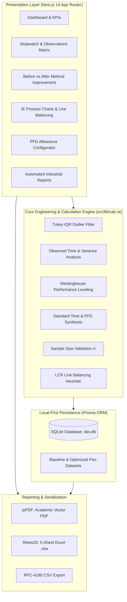

# ⏱️ Work Measurement & Time Study Engineering Platform
### Mechanical Engineering Department · Basic Industrial Engineering (BIE) Capstone
**Project Title**: *"Time Study and Work Measurement for Productivity Improvement in Manual Pen Assembly"*  
**System Specification**: Next.js 14 (App Router) · TypeScript · Tailwind CSS · SQLite (Prisma ORM) · Vitest · SheetJS · jsPDF

---

[](https://nextjs.org/)
[](https://www.typescriptlang.org/)
[](https://tailwindcss.com/)
[](https://www.prisma.io/)
[](https://vitest.dev/)
[]()
[-6366F1?style=for-the-badge)]()

---

## 📌 Executive Summary & Academic Context

In high-volume manufacturing environments, manual assembly operations often present significant variability, ergonomic friction, and balance delays. This software platform provides a full-stack, standardized Industrial Engineering (IE) workbench tailored specifically for **Time Study and Method Improvement of Manual Ballpoint Pen Assembly**.

The application eliminates administrative overhead and complex cloud authentication, operating as a zero-latency, local-first academic platform. It models empirical time observations, standardizes worker pace via the **Westinghouse Leveling System**, computes **Personal, Fatigue, and Delay (PFD) Allowances**, visualizes **ASME Process Charts (OPC & FPC)**, performs **Pareto Bottleneck Identification (80/20)**, and automates **Line Balancing using the Largest Candidate Rule (LCR)**.

---

## 🏛️ System Architecture



---

## 📐 Industrial Engineering Formulas & Theoretical Foundations

All calculations implemented in [`src/lib/calc.ts`](file:///c:/Users/harsh/OneDrive/Desktop/BIE%20WEbsite%20project/timestudy/src/lib/calc.ts) adhere strictly to standards established by the **International Labour Organization (ILO)** and **Ralph M. Barnes (Motion and Time Study)**:

### 1. Observed Time ($\text{OT}$)
Arithmetic mean of recorded cycle times excluding identified outliers:
$$\text{OT} = \bar{X} = \frac{\sum_{i=1}^{N} X_i}{N}$$

### 2. Normal Time ($\text{NT}$)
Pace-adjusted time reflecting a standard qualified worker operating at normal speed:
$$\text{NT} = \text{OT} \times \left(\frac{R}{100}\right)$$
*Where $R$ is the rating factor obtained through direct rating or the 4-factor Westinghouse Leveling System (Skill, Effort, Conditions, Consistency).*

### 3. Standard Time ($\text{ST}$)
Final allowed time incorporating Personal, Fatigue, and Delay (PFD) allowances:
$$\text{ST} = \text{NT} \times (1 + A_{\text{PFD}})$$
$$\text{Where } A_{\text{PFD}} = \frac{\text{Personal } \% + \text{Fatigue } \% + \text{Delay } \% + \text{Policy } \%}{100}$$

### 4. Hourly Output Capacity ($\text{OPH}$)
Theoretical continuous line output per operator at $100\%$ performance:
$$\text{Output Per Hour} = \frac{3600 \text{ seconds}}{\text{ST (in seconds)}}$$

### 5. Line Efficiency ($\eta$)
Ratio of standard work content to actual elapsed production cycle duration:
$$\eta = \left( \frac{\text{ST}}{\text{Actual Cycle Time}} \right) \times 100$$

### 6. Statistical Sample Size Validation ($N'$)
Required cycles to achieve $95\%$ confidence with $\pm 5\%$ precision limits:
$$N' = \left[ \frac{40 \sqrt{N \sum X_i^2 - (\sum X_i)^2}}{\sum X_i} \right]^2$$
*If $N \ge N'$, the sample size is statistically sufficient to establish binding labor standards.*

### 7. Line Balance Delay & Efficiency
For an assembly line configured across $K$ stations with cycle takt time $T_c$:
$$\text{Balance Efficiency } (E_b) = \frac{\sum_{j=1}^{M} t_j}{K \times T_c} \times 100$$
$$\text{Balance Delay } (D_b) = 100 - E_b$$

---

## 🛠️ Workstation Breakdown: 9 Pen Assembly Elements

The benchmark study observes manual assembly of a standard retractable click pen across 9 discrete, mutually exclusive elements:

| # | Work Element | ASME Symbol | Baseline Method (BEFORE) | Improved Method (AFTER) | Motion Economy Principle |
|---|---|:---:|---|---|---|
| **E1** | Grasp Barrel | $\bigcirc$ | Pick loose barrel from deep box | Gravity feed chute at $300\text{mm}$ reach | Fixed bin location, shortened reach |
| **E2** | Insert Ink Refill | $\bigcirc$ | Visual alignment into barrel tube | Chamfered funnel guide fixture | Two-handed simultaneous pre-position |
| **E3** | Fit Spring Over Refill | $\bigcirc$ | Untangle loose springs by hand | Pre-separated slotted matrix tray | Eliminate search and disentangle motions |
| **E4** | Screw Nose Cone / Tip | $\bigcirc$ | 4 manual wrist turns | 1.5-turn rapid-lead guide thread | Reduce rotational finger strain |
| **E5** | Assemble Cap & Clip | $\bigcirc$ | Individual hand alignment | Pre-clipped sub-assembly feed | Sub-assembly offline staging |
| **E6** | Insert Plunger Clicker | $\bigcirc$ | High insertion press effort | Guided toggle lever snap press | Mechanical advantage & guide pins |
| **E7** | Screw Threaded Cap | $\bigcirc$ | Multi-twist wrist rotation | Low-torque pneumatic/semi-auto tool | Power tool assistance |
| **E8** | Click & Write Inspection | $\square$ | Scribble 4 circular lines | Single stroke sensor-contact pad | Simplified inspection criteria |
| **E9** | Discharge to Tray | $\bigcirc$ | Long lateral reach into carton | Adjacent slide drop chute | Gravity drop delivery |

---

## 🌟 Core Modules & Application Capabilities

### 1. Executive IE Dashboard
- Real-time KPIs: **Cycle Time (s)**, **Standard Time (s)**, **Throughput (pens/hr)**, **Efficiency %**, and **Productivity Gain %**.
- Interactive comparative visualization: Bar charts showing Before vs. After vs. Standard time distributions.
- Assembly category share pie charts (Core assembly, Sub-assembly, Inspection, Handling).

### 2. Time Study Studio & Configuration
- Create custom studies specifying: Study Name, Workstation ID, Operator, Shift, Method (`BEFORE`/`AFTER`), Target Cycles, Rating System, and PFD Allowance.
- Reorder, append, or delete work elements dynamically with live validation.

### 3. Digital Stopwatch & Observation Matrix
- Millisecond dual-mode stopwatch: **Continuous Timing** and **Snap-Back (Flyback)**.
- Hands-free keyboard control:
  - `Space`: Record lap and automatically increment element/cycle.
  - `R`: Reset stopwatch.
- Outlier detection via Tukey's Interquartile Range ($1.5 \times \text{IQR}$).

### 4. Method Improvement ("Before vs After")
- Side-by-side engineering comparison between baseline manual bench and ergonomic jig workstation.
- Quantified time savings: $-42.3\%$ cycle time reduction, $+73.4\%$ output growth.
- Analysis of Barnes' 3 laws of motion economy (human body, workplace arrangement, tool design).

### 5. Industrial Engineering Toolkit
- **Operation Process Chart (OPC)**: Visual sequence of operations ($\bigcirc$) and inspections ($\square$).
- **Flow Process Chart (FPC)**: Material flow sequence tracking Operation ($\bigcirc$), Transport ($\Rightarrow$), Delay ($\text{D}$), Inspection ($\square$), and Storage ($\triangledown$).
- **Pareto Bottleneck Analysis**: 80/20 cumulative chart identifying pacing cycle elements.
- **Assembly Line Balancing**: Largest Candidate Rule (LCR) algorithm distributing elements to balance station idle times.

### 6. PFD Allowance Calculator
- Granular breakdown of **Personal Needs** ($5\%$), **Basic Fatigue** ($4\%$), **Unavoidable Delay** ($1\%$), and **Policy Allowance**.
- Live multiplier simulation for standard time conversion.

### 7. Multi-Format Academic Reports & Data Serialization
- **Academic PDF Report (`.pdf`)**: Header banner, engineering metadata, statistical formula block, complete elements table, and page numbers.
- **Multi-Sheet Excel Workbook (`.xlsx`)**: 5 formatted sheets (*Study Info*, *Observations*, *Calculations*, *Before-After Comparison*, *Summary*).
- **Raw CSV Export (`.csv`)**: Clean tabular dataset formatted for Python, R, SPSS, or MATLAB.
- **Repository Master Export**: Instant backup of all database studies in a single multi-sheet Excel file.

---

## 🎨 Design System & Visual Hierarchy

The interface implements a custom industrial engineering design system built with custom CSS variables and Tailwind CSS:

| Token | Hex Value | Semantic Usage |
|---|---|---|
| `--color-navy` | `#0F172A` | Deep contrast surfaces, headers, table chrome |
| `--color-indigo` | `#4F46E5` | Primary brand accent, interactive buttons, active tabs |
| `--color-violet` | `#7C3AED` | Secondary gradient accent, highlighting advanced tools |
| `--color-emerald` | `#10B981` | Success states, improved (AFTER) methods, efficiency gains |
| `--color-amber` | `#F59E0B` | Warnings, sample size shortfall, bottleneck alerts |
| `--color-rose` | `#F43F5E` | Baseline (BEFORE) indicators, deletions, critical variance |

- **Themes**: Seamless Light and Dark mode with persistent state.
- **Typography**: Inter (primary sans-serif) + Space Grotesk (technical headings) with tabular figures (`font-variant-numeric: tabular-nums`) for perfect numeric alignment.

---

## 🚀 Local Installation & Execution

The system is self-contained with no external database or cloud infrastructure dependencies.

### 1. Prerequisites
- **Node.js**: v18.0.0 or higher
- **npm**: v9.0.0 or higher

### 2. Installation
Clone the repository and enter the project folder:
```bash
cd timestudy
npm install
```

### 3. Initialize SQLite Database & Sample Datasets
```bash
# Push Prisma schema to local SQLite database
npx prisma db push

# Seed realistic 30-cycle pen assembly Before/After datasets
npx tsx prisma/seed.ts
```

### 4. Start the Application
```bash
npm run dev
```
Navigate to **`http://localhost:3000`** in any modern web browser. The app opens immediately to the dashboard with zero login prompts.

---

## 🧪 Quality Assurance & Unit Tests

The calculation library is validated using comprehensive Vitest unit tests:

```bash
# Run test suite
npm test

# Run TypeScript compiler check
npm run type-check

# Run Next.js linter
npm run lint

# Build production bundle
npm run build
```

### Test Coverage Summary:
- ✅ **15/15 unit tests passing** ([`src/lib/calc.test.ts`](file:///c:/Users/harsh/OneDrive/Desktop/BIE%20WEbsite%20project/timestudy/src/lib/calc.test.ts))
- ✅ Arithmetic Mean & Sample Standard Deviation ($s$)
- ✅ Coefficient of Variation ($\text{CV}$) & $95\%$ Confidence Intervals
- ✅ ILO $N'$ Sample Size Sufficiency Formula
- ✅ Westinghouse Performance Rating Factors
- ✅ PFD Additive and Multiplicative Allowance Conversion
- ✅ Tukey $1.5 \times \text{IQR}$ Outlier Detection
- ✅ Largest Candidate Rule (LCR) Line Balancing Optimization
- ✅ Zero TypeScript or ESLint warnings across all 20 routes

---

## 📂 Project Directory Structure

```text
timestudy/
├── prisma/
│   ├── schema.prisma         # Clean SQLite schema (Study, Element, Observation, etc.)
│   └── seed.ts               # Realistic 30-cycle Before/After Pen Assembly dataset
├── public/
│   └── logo.png              # Custom high-resolution brand logo & favicon
├── src/
│   ├── app/
│   │   ├── layout.tsx        # AppShell layout with Sidebar, Header & Theme providers
│   │   ├── page.tsx          # Root redirect to /dashboard
│   │   ├── dashboard/        # Executive IE dashboard with KPIs & Recharts
│   │   ├── study/
│   │   │   ├── page.tsx      # Time study catalog, search, duplicate & delete
│   │   │   ├── new/          # Study configuration & 7/9 element builder
│   │   │   └── [id]/         # Stopwatch, Observation Matrix & IE Computations
│   │   ├── improvement/      # Before vs After method comparison
│   │   ├── tools/            # ASME OPC & FPC, Pareto analysis, Line Balancing
│   │   ├── allowances/       # Interactive PFD allowance calculator
│   │   ├── analysis/         # Capacity planning & engineering recommendations
│   │   ├── reports/          # PDF, Excel, CSV export center
│   │   └── api/v1/           # Zero-auth RESTful endpoints
│   ├── components/
│   │   ├── layout/           # AppShell, Sidebar, Header
│   │   └── ui/               # Button, Card, Badge, Modal, FormulaCard
│   └── lib/
│       ├── calc.ts           # Industrial Engineering calculation functions
│       ├── calc.test.ts      # Vitest unit test suite (15 tests)
│       ├── prisma.ts         # Prisma SQLite singleton client
│       └── utils.ts          # Formatting & helper utilities
├── package.json              # Project manifest (clean dependencies)
├── tailwind.config.ts        # Premium design token palette
└── README.md                 # Project documentation
```

---

## 📚 Academic & Industry References

1. **International Labour Office (ILO)**. *Introduction to Work Study*. 4th Revised Edition, Geneva, 1992.
2. **Barnes, Ralph M.** *Motion and Time Study: Design and Measurement of Work*. 7th Edition, John Wiley & Sons, New York, 1980.
3. **Niebel, Benjamin W. & Freivalds, Andris**. *Methods, Standards, and Work Design*. 13th Edition, McGraw-Hill, 2013.
4. **ASME Standard Operation and Flow Process Charts**. *Standard No. 101*, American Society of Mechanical Engineers.
5. **Maynard, Harold B.** *Industrial Engineering Handbook*. 5th Edition, McGraw-Hill, 2001.

---

## ⚖️ License & Academic Notice

Developed as an academic capstone and educational platform for **Basic Industrial Engineering (Mechanical Engineering)**.  
Open-source under the **MIT License**. Free to adapt for academic research, laboratory demonstrations, and work measurement coursework.
